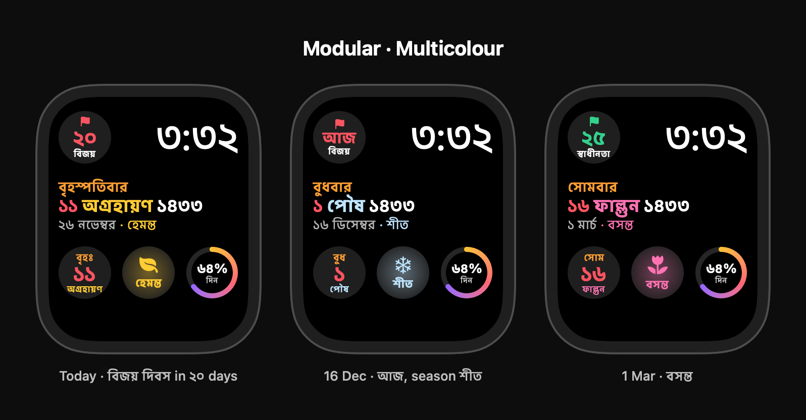
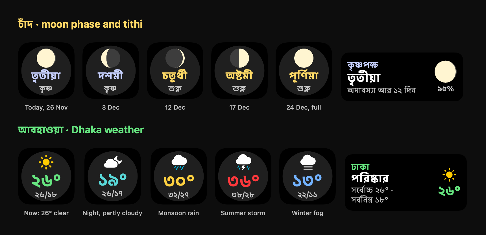
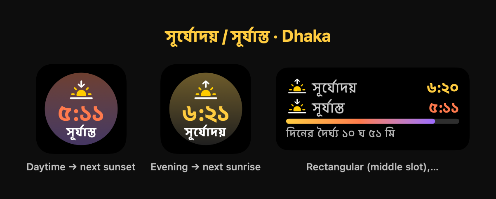
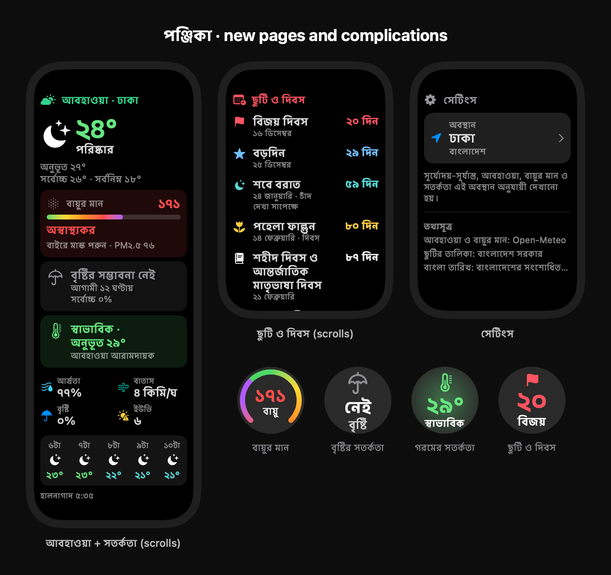
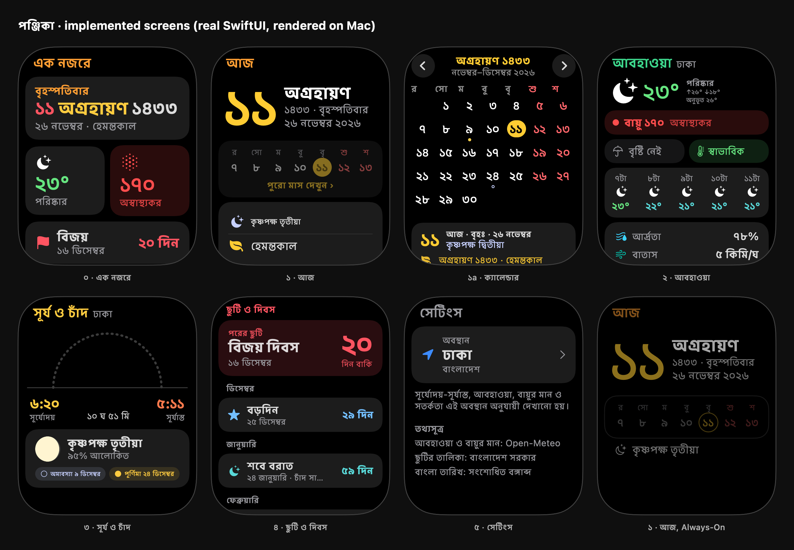

# পঞ্জিকা (Ponjika)

**A Bangla almanac for Apple Watch.** Ponjika puts the Bangla calendar, the six seasons, sunrise and sunset, the moon's tithi, weather, air quality, rain and heat alerts, and Bangladesh's government holidays on your watch face. Everything is in Bangla with Bengali numerals.



- **10 complications** for your watch face, in circular, rectangular, inline and corner sizes
- **A watch app** with pages of detail. Tapping a complication opens its page.
- **Choose your city.** Pick from Bangladesh's divisions and major districts or popular cities abroad, or search any city worldwide. Sun times, weather, air quality and alerts follow it.
- **Works offline** for the calendar, seasons, sun, moon and holidays. Weather, air quality and alerts need an internet connection: no account, no API key and no location permission.

---

## Contents

- [What you get](#what-you-get)
- [Requirements](#requirements)
- [Install on your Apple Watch](#install-on-your-apple-watch)
- [Set up your watch face](#set-up-your-watch-face)
- [Troubleshooting](#troubleshooting)
- [How it works](#how-it-works)
- [Project layout](#project-layout)

---

## What you get

### Complications

| Complication | Shows | Sizes | Tap opens |
|---|---|---|---|
| **বাংলা তারিখ** | Weekday, Bangla date and year, Gregorian date | circular · rectangular · inline · corner | আজ |
| **ঋতু** | The current season (গ্রীষ্ম, বর্ষা, শরৎ, হেমন্ত, শীত, বসন্ত) | circular · inline · corner | আজ |
| **দিনের অগ্রগতি** | How much of today has passed | circular · corner | আজ |
| **ছুটি ও দিবস** | Days to the next government holiday or national day, including Eid and Puja | circular · rectangular · inline · corner | ছুটি ও দিবস |
| **সূর্যোদয় / সূর্যাস্ত** | Next sunrise or sunset for your city | circular · rectangular · inline · corner | সূর্য ও চাঁদ |
| **চাঁদ** | Moon phase, tithi, শুক্ল/কৃষ্ণ পক্ষ | circular · rectangular · inline · corner | সূর্য ও চাঁদ |
| **আবহাওয়া** | Temperature, conditions, high/low | circular · rectangular · inline · corner | আবহাওয়া |
| **বায়ুর মান** | Air quality (US AQI), colour-coded from ভালো to বিপজ্জনক | circular · rectangular · inline · corner | আবহাওয়া |
| **বৃষ্টির সতর্কতা** | When rain is likely in the next 12 hours ("বিকেল ৪টা") | circular · rectangular · inline · corner | আবহাওয়া |
| **গরমের সতর্কতা** | Feels-like temperature with heat (গরম → চরম গরম), cold and UV warnings | circular · rectangular · inline · corner | আবহাওয়া |







### The app

Turn the Digital Crown to move between pages:

1. **আজ**: weekday, Bangla date and year (বঙ্গাব্দ), Gregorian date, season, today's holiday if any, day progress
2. **আবহাওয়া**: temperature and conditions; **বায়ুর মান** with advice and PM2.5; **বৃষ্টির সতর্কতা**; **গরমের সতর্কতা** with UV; humidity, wind, chance of rain, UV index; and the next 5 hours
3. **সূর্য ও চাঁদ**: sunrise, sunset, day length, moon phase, tithi, and the dates of the next পূর্ণিমা and অমাবস্যা
4. **ছুটি ও দিবস**: every government holiday and national day in the next 12 months, with days remaining. Multi-day holidays such as Eid show as a date range; moon-dependent dates are marked চাঁদ দেখা সাপেক্ষে.
5. **সেটিংস**: choose your city



---

## Requirements

| | |
|---|---|
| **Watch** | Apple Watch on **watchOS 11 or later** (Series 6 and newer, SE 2nd gen, Ultra) |
| **iPhone** | Paired with the watch |
| **Mac** | With **Xcode 16 or later** (tested with Xcode 27.2) |
| **Apple ID** | A free Apple ID works. A paid Apple Developer account ($99/year) keeps the app working for a year instead of 7 days. |

Apple Watch apps can only be installed from the App Store or built from source with Xcode. This project isn't on the App Store, so you build it yourself. It takes about 15 minutes the first time.

---

## Install on your Apple Watch

### 1. Get the code

```bash
git clone https://github.com/parag44/ponjika.git
cd ponjika
```

Or download the ZIP from GitHub and unzip it.

### 2. Add your Apple ID to Xcode

Open **Xcode → Settings → Accounts**, click **+**, and sign in with your Apple ID. Xcode creates a free "Personal Team" for you.

### 3. Set your signing details

Every app on a watch needs a unique bundle ID and your team. Copy the example file:

```bash
cp Config/Signing.local.xcconfig.example Config/Signing.local.xcconfig
```

Then edit `Config/Signing.local.xcconfig`:

```
PONJIKA_BUNDLE_ID_PREFIX = com.yourname.ponjika
DEVELOPMENT_TEAM = ABCDE12345
```

- **Bundle ID prefix:** anything unique to you, in reverse-domain style, for example `com.rahim.ponjika`. Use only letters, numbers, dots and hyphens.
- **Team ID:** in **Xcode → Settings → Accounts**, select your team. The 10-character ID is shown there. You can also find it in the Apple Developer website's Membership section.

This file is git-ignored, so your details stay on your Mac.

### 4. Turn on Developer Mode

The iPhone and the watch both need Developer Mode before they'll run apps you build:

1. Connect the iPhone to the Mac with a cable once and tap **Trust** if asked.
2. On the **iPhone**: **Settings → Privacy & Security → Developer Mode** → on. Restart when asked.
3. On the **watch**: **Settings → Privacy & Security → Developer Mode** → on. Restart when asked.

If Developer Mode doesn't appear on the watch, open the project in Xcode with the watch nearby and unlocked (step 5). It shows up after Xcode has seen the watch.

### 5. Build and install

1. Open **`Ponjika.xcodeproj`** in Xcode.
2. In the toolbar, choose the **Ponjika** scheme and your **Apple Watch** as the run destination. The watch is listed under your iPhone.
3. **Recommended:** **Product → Scheme → Edit Scheme… → Run → Info**, untick **Debug executable**. This skips a very slow one-time debug-symbol copy from the watch, which can take 30+ minutes.
4. Press **⌘R**.

Keep the watch **unlocked, on its charger and near the iPhone**, with the iPhone and Mac on the **same Wi-Fi**. The first install takes a few minutes.

### 6. Trust the developer (free Apple ID only)

If the watch says the app is from an untrusted developer, on the **iPhone** go to **Settings → General → VPN & Device Management**, tap your Apple ID and choose **Trust**.

### 7. Open the app once

Press the Digital Crown, find **পঞ্জিকা**, and open it. This registers the complications with watchOS and loads the first weather reading.

### 8. Choose your city

Turn the Digital Crown to the last page, **সেটিংস**, and tap **অবস্থান**. Pick a city from **বাংলাদেশ** or **প্রবাসে**, or type a city name in English to search worldwide. The app and all complications update to that city. The default is Dhaka.

> **Free Apple ID:** apps you install this way stop opening after **7 days**. Connect the watch and press ⌘R in Xcode again to renew. Your face setup stays.

---

## Set up your watch face

Apple doesn't allow third-party watch faces, so Ponjika provides complications that you place on one of Apple's faces.

### Recommended face

**Modular**, **Modular Duo** or **Infograph Modular**, with **Colour → Multicolour**. Without Multicolour, watchOS tints every complication one colour.

A layout where every slot shows something different:

| Slot | Complication |
|---|---|
| Top Left | **আবহাওয়া** (or **বায়ুর মান**, **ছুটি ও দিবস**) |
| Date | **Off** (the middle slot already shows the date) |
| Middle | **বাংলা তারিখ** |
| Bottom Left | **সূর্যোদয় / সূর্যাস্ত** |
| Bottom Middle | **ঋতু** |
| Bottom Right | **চাঁদ** (or **বৃষ্টির সতর্কতা**, **গরমের সতর্কতা**) |

**Seasonal tip:** in winter, put **বায়ুর মান** in a slot (Dhaka's air is worst from November to February). In monsoon, use **বৃষ্টির সতর্কতা**; in summer, **গরমের সতর্কতা**.

To show the time in Bangla too, set **Numerals → Bangla** in the face editor (Watch app → your face). Faces that offer it include Modular and Modular Duo.

### Add complications on the iPhone (easier)

1. Open the **Watch** app → **My Watch** → under **My Faces**, tap your face. You can also add Modular from **Face Gallery**.
2. Set **Colour** to **Multicolour**.
3. Under **Complications**, tap a slot (e.g. **Middle**).
4. Scroll to the **পঞ্জিকা** section and pick a complication.
5. Repeat for each slot, then tap **Set as current Watch Face**.

### Add complications on the watch

1. Touch and hold the face, then tap **Edit**.
2. Swipe left to **Complications**.
3. Tap a slot, turn the Digital Crown to **পঞ্জিকা**, and tap a complication.
4. Press the Digital Crown to save, then tap the face.

### Tips

- **Tap any Ponjika complication** to open the matching page in the app.
- The **inline** sizes fit the thin slot at the top of faces like Infograph Modular and Modular Compact.
- The **corner** sizes fit faces like Infograph, California and Meridian.

---

## Troubleshooting

| Problem | Fix |
|---|---|
| **Stuck on "Copying OS library symbols (0%)"** | Untick **Debug executable** in the scheme (step 5.3) and press ⌘R again, or wait it out (it only happens once per watchOS version). |
| **Watch doesn't appear as a run destination** | Unlock the iPhone and watch, put both on the same Wi-Fi as the Mac, and check **Window → Devices and Simulators**. Make sure Developer Mode is on (step 4). |
| **"No Accounts" or "No profiles for … were found"** | Add your Apple ID in **Xcode → Settings → Accounts**, check `DEVELOPMENT_TEAM` in `Config/Signing.local.xcconfig`, then build once from Xcode (not the command line). |
| **"Bundle identifier is not available"** | Someone else already uses that ID. Change `PONJIKA_BUNDLE_ID_PREFIX` to something more unique. |
| **Ponjika isn't in the complications list** | Open the পঞ্জিকা app once on the watch, wait a minute, then edit the face again. If it's still missing, restart the watch. |
| **Complications are all one colour** | Set the face's **Colour** to **Multicolour**. |
| **Weather, air or alerts show `--`** | They need an internet connection through the iPhone or Wi-Fi. Open the app's আবহাওয়া page to fetch now. After that they refresh about every 30 minutes. |
| **Complications still show Dhaka after changing city** | The app and complications share the city through an App Group. Make sure the build includes the App Group capability (it's set in `project.yml`), then open the app and change the city again. watchOS may take a few minutes to redraw complications. |
| **App stopped opening after a week** | Free Apple ID limit. Build and install again from Xcode. |

---

## How it works

| Feature | Method | Accuracy |
|---|---|---|
| **Bangla date** | Bangladesh's revised calendar (2019): Pohela Boishakh = 14 April, the first six months have 31 days, Falgun has 30 days in leap years. 1 Poush = 16 December, 8 Falgun = 21 February. | Exact |
| **Seasons** | Two Bangla months per season | Exact |
| **Sunrise / sunset** | NOAA solar equations for your chosen city, shown in that city's time zone | Within about a minute (a few minutes at high latitudes) |
| **Moon phase & tithi** | Meeus low-precision lunar theory; tithi = each 12° of sun–moon elongation | Within ~30 minutes of published new and full moons |
| **Weather** | [Open-Meteo](https://open-meteo.com) forecast API | Updated about every 30 minutes |
| **Air quality** | Open-Meteo air-quality API, US AQI with Bangla bands: ভালো (0–50), মাঝারি (51–100), সংবেদনশীলদের জন্য অস্বাস্থ্যকর (101–150), অস্বাস্থ্যকর (151–200), খুব অস্বাস্থ্যকর (201–300), বিপজ্জনক (301+) | Hourly model data |
| **Rain alert** | First hour in the next 12 with ≥40% chance or ≥0.3 mm of rain | Forecast-based |
| **Heat alert** | Higher of current and today's peak feels-like temperature: গরম ≥35°, তীব্র গরম ≥38°, চরম গরম ≥41°; ঠান্ডা <10°, তীব্র শীত <0°. UV warnings at 6, 8 and 11+ | Forecast-based |
| **Holidays** | Bangladesh government list: 2027 from the cabinet-approved list (2 November 2026). Fixed-date holidays every year. For years without a published list, Islamic holidays are calculated from the Umm al-Qura calendar + 1 day, which matches every official 2027 date; lunar Hindu and Buddhist holidays appear once a year's list is added. | Exact for listed years; Islamic dates otherwise depend on moon sighting |

### Privacy

Ponjika doesn't collect anything and never uses your location. Network requests go only to Open-Meteo: weather and air quality requests contain the coordinates of the city you chose, and a city search sends the name you typed. No identifiers are sent. Everything else is calculated on the watch.

### Updating the holiday list

Each year's government list is in `Shared/Holidays.swift` (`official`). When Bangladesh publishes a new year's list, add an entry for that year with its lunar and moving holidays; fixed-date holidays are added automatically.

---

## Project layout

```
Ponjika/                 Watch app: dashboard pages, settings and city picker, app icon
PonjikaWidgets/          Complications (WidgetKit extension)
Shared/                  Used by both: Bangla calendar, holidays, places and settings,
                         weather/air/alerts, sun, moon
Config/
  Signing.xcconfig                 Defaults (don't edit)
  Signing.local.xcconfig.example   Copy to Signing.local.xcconfig and fill in
docs/images/             README screenshots
project.yml              XcodeGen spec that generates Ponjika.xcodeproj
```

`Ponjika.xcodeproj` is generated from `project.yml` with [XcodeGen](https://github.com/yonaskolb/XcodeGen) and committed, so you can open it directly. If you add or remove files, regenerate it:

```bash
brew install xcodegen
xcodegen generate
```

### Building from Terminal

```bash
xcodebuild -project Ponjika.xcodeproj -scheme Ponjika -configuration Release -destination 'generic/platform=watchOS' -allowProvisioningUpdates build
```

If `xcodebuild` says it requires Xcode, point it at Xcode with `sudo xcode-select -s /Applications/Xcode.app`.

Build once from Xcode first, so it can create the signing profiles for your bundle ID.
